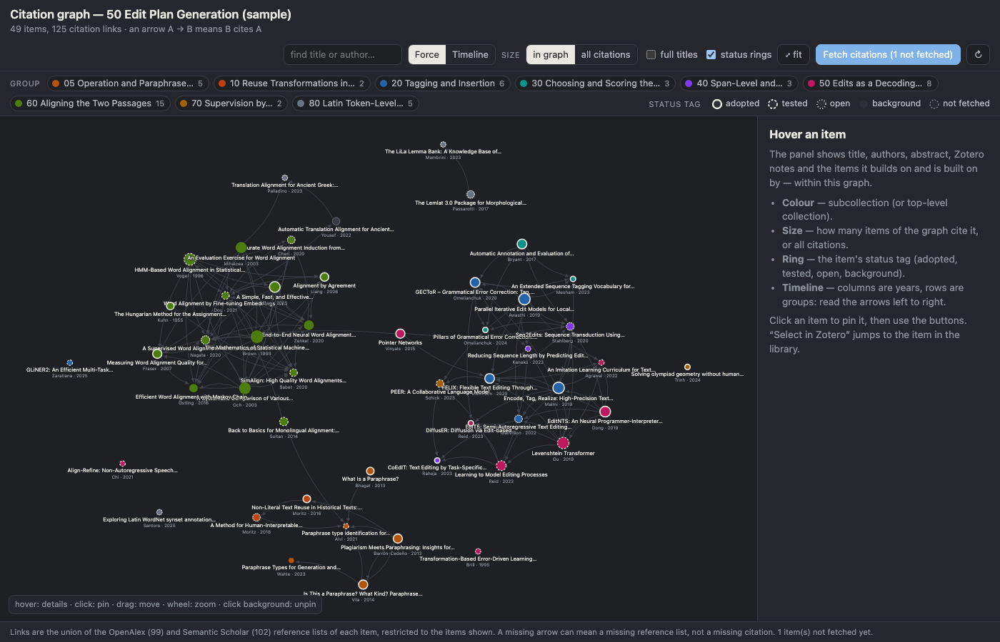
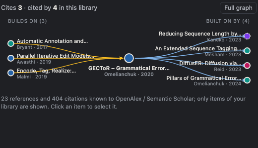

# Citation Graph for Zotero

A Zotero plugin that draws the citation network **of your own library**: which of the papers in a collection cite which, as a force-directed graph or as a timeline, and — for the paper you have selected — what it builds on and what builds on it, right in the item pane.

The edges are real citations: each item is looked up in [OpenAlex](https://openalex.org) and [Semantic Scholar](https://www.semanticscholar.org), their reference lists are fetched, and every reference that points at another item of your library becomes an arrow. Nothing leaves your machine except the title/DOI lookups; nothing in your library is modified.

> Status: **0.1.0, first version.** Written against Zotero 10.0 (also declares compatibility from Zotero 7). Please report what breaks.





*(Previews rendered from the page in development mode with the example data in `dev/`.)*

## What you get

| Where | What |
|---|---|
| **Tab** — right-click a collection → *Show Citation Graph*, or *Tools → Citation Graph* | The graph of the collection (subcollections included). Colour = subcollection, size = how many items of the graph cite it (or all citations, log scale), ring = a status tag (`status:adopted`, `status:tested`, … — configurable). **Force** layout, or **Timeline**: one column per year, one row per subcollection, so arrows read left to right as "what was derived from what". Search, group toggles, zoom/pan/drag, full titles. |
| **Detail panel** (hover / click to pin) | Title, authors, venue, abstract, your Zotero notes, *Builds on* / *Built on by* lists (click to navigate), *Select in Zotero*, DOI, fetch, status tag. |
| **Item pane → "Citations" section** | The selected paper in the middle, the library items it cites on the left, the items citing it on the right. Click a node to select that item. Header buttons open the full graph or fetch the item. |
| **Fetching** | *Tools → Citation Graph → Fetch Citations…*, the collection or item context menus, the *Fetch citations* button in the graph, or the section button. A progress window shows what is happening; results are cached in `<Zotero data directory>/citation-graph/cache.json`, so a rebuild only fetches new items. |
| **Settings** (Zotero → Settings → Citation Graph) | Semantic Scholar on/off and API key, OpenAlex polite-pool e-mail, status tag prefix and values, whether Zotero's own *Related* links are drawn, section height, clear cache. |

The graph can also be built for a whole library or for the currently selected items (*Tools → Citation Graph → Show Graph for Selected Items*).

## Install

1. Download `citation-graph-<version>.xpi` from the [releases](https://github.com/julianschelb/zotero-citation-graph/releases) (or build it, see below).
2. In Zotero: *Tools → Plugins → ⚙ → Install Plugin From File…* and pick the `.xpi`.
3. Select a collection, then *Tools → Citation Graph → Fetch Citations for Selected Collection or Library…*. Wait for the progress window, then *Show Graph…*.

Fetching speed: OpenAlex answers batches of DOIs at once; Semantic Scholar's public API allows about one request per second, so a collection of 50 items takes roughly a minute, mostly for items without a DOI. A free [Semantic Scholar API key](https://www.semanticscholar.org/product/api) removes most of the waiting.

## How the edges are found

1. Every item is resolved in OpenAlex by DOI (batched) and by title search; the title search also collects the duplicate records (arXiv version, venue version) so references pointing at either match.
2. If enabled, every item is resolved in Semantic Scholar (batch endpoint, references included), with a title search as fallback.
3. For each item, the two reference lists are matched against the other items by OpenAlex ID, Semantic Scholar ID, DOI or normalised title. An arrow A → B means *B cites A*; the detail panel shows which source (OA, S2, related) produced it.
4. Optionally, Zotero's *Related* links are added as edges, directed from the older to the newer item.

A missing arrow can mean a missing or unresolved reference list rather than a missing citation — the footer of the graph says how many items were not found.

## Development

```
git clone https://github.com/julianschelb/zotero-citation-graph
cd zotero-citation-graph
npm run check      # syntax check of every script
npm run build      # build/citation-graph-<version>.xpi + updates.json (needs the `zip` CLI)
```

To iterate on the page without restarting Zotero, open `content/graph.html?dev#full` or `?dev#ego` in a browser: `dev/sample-host.js` plays the plugin with example data. For the plugin itself, install the built `.xpi`, or symlink the checkout: put a file named after the plugin ID (`citation-graph@julianschelb.github.io`) containing the absolute path of the checkout into `<Zotero profile>/extensions/`, then restart Zotero with `-purgecaches`. Debug output goes to *Help → Debug Output Logging* (`Zotero.debug("Citation Graph: …")`).

### Layout

```
bootstrap.js                 Zotero entry point (startup / shutdown / window hooks)
manifest.json, prefs.js      plugin metadata, default preferences
src/plugin.js                menus, tab, item-pane section, settings pane, graph data, the host API
src/resolver.js              OpenAlex + Semantic Scholar lookups, cache, edge matching
content/graph.html|css|js    the visualisation (runs in an iframe; #full or #ego)
content/preferences.*        the settings pane
locale/en-US/*.ftl           strings
lib/d3.min.js                D3 v7 (ISC)
dev/sample-host.js           example data for working on the page outside Zotero
scripts/build.mjs            packs the .xpi and writes updates.json
```

See [docs/ARCHITECTURE.md](docs/ARCHITECTURE.md) for how the pieces talk to each other.

### Releasing

Bump `version` in `manifest.json` and `package.json`, update `CHANGELOG.md`, tag `vX.Y.Z` and push the tag: the workflow builds the `.xpi` and attaches it together with `updates.json` to the GitHub release, which is what Zotero polls for updates.

## Privacy

Lookups send titles and DOIs of the items you fetch to api.openalex.org and api.semanticscholar.org. The optional e-mail and API key are sent only to the respective service. The cache stays in your Zotero data directory.

## License

MIT. D3 is © Mike Bostock, ISC.
